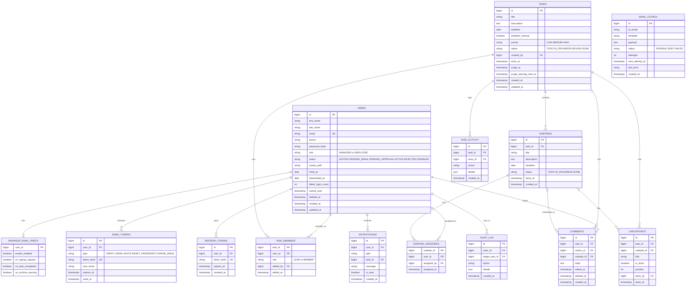

# Task Management System — SRS

Oct 25, 2026 · @ahmed mo

## 1. Overview

A web app where a Manager creates tasks (each one a small project), assigns employees, and follows every task through review to done. Each task has at most one Task Lead, who acts as the Manager's deputy on that task only.

**How to use this document.** Keep it in the repo as `docs/SRS.md` and give the AI coding tool one phase at a time (section 11). Rules are numbered (BR-1, BR-2, and so on) so prompts and tests can point at them. Items marked ⚠️ were assumptions and have all been confirmed; section 12 lists them. If the tool finds a contradiction, it must stop and ask instead of guessing.

| Term | Meaning |
| --- | --- |
| Manager | Global role with full privileges. Several Manager accounts are allowed. |
| Employee | Global role for everyone else. |
| Task | A project-like unit of work: title, description, deadline, priority, members, optional subtasks and checkpoints. |
| Subtask | A part of a task with its own title, description, deadline and one or more assignees. |
| Checkpoint | Optional checklist item inside a task or a subtask. It has no deadline. |
| Task Lead | The single employee marked as lead on one task. Same employee can be Lead on one task and Member on another. |
| Member | An employee assigned to a task who is not its Lead. |
| Task pool | The list of all tasks, visible read-only to every active user. |
| Archive | Done tasks, kept 30 days and then deleted with everything related to them. |

There are no fixed teams. The people assigned to a task are its team.

## 2. Tech stack and conventions

The stack is Spring Boot, PostgreSQL and JWT on the backend, React with Vite on the frontend, and the whole UI is in English.

| Layer | Choice |
| --- | --- |
| Backend | Java 17 or newer, Spring Boot 3.x, Spring Security, Spring Data JPA, Bean Validation, Spring Mail, `@Scheduled` jobs |
| Database | PostgreSQL, schema managed only by Flyway migrations |
| Auth | JWT access token plus rotating refresh token (section 5) |
| Frontend | React with Vite, React Router, a data-fetching library with polling support (for example TanStack Query). TypeScript preferred. |
| Email | Gmail SMTP with an App Password, sent asynchronously (section 9) |
| Local setup | `docker-compose.yml` for PostgreSQL, a README with run steps |

**Conventions**

- All endpoints live under `/api`, return JSON, and use one error shape: `{ "status", "code", "message", "fieldErrors": [{ "field", "message" }] }`.
- Timestamps are stored in UTC. Deadlines are plain `date` values with no time, because some staff work remotely on flexible hours. "Today" and overdue checks use the Africa/Cairo time zone.
- Nothing is hard-deleted except what section 8 says. Users are soft-deleted so they can be restored from the database.
- Secrets and settings come from environment variables only: database URL and credentials, JWT secret, SMTP host, user and App Password, `APP_BASE_URL` (used in email links), upload directory, and the seed Manager's name, email and password.
- On first start, if the `users` table is empty, the app creates one Manager from the seed variables. There is no public Manager sign-up.
- Lists are paginated (default 20, maximum 100) and sorted explicitly.
- Business rules live in service classes, not controllers, and are covered by unit tests (section 10).

## 3. Roles and permissions

There are two global roles (Manager, Employee) and two per-task roles (Lead, Member). Every action in the table is checked on the server, so hiding a button in the UI is never enough.

**BR-1.** Per-task roles are stored in `task_members`. The same employee can be Lead on one task and Member on another.

**BR-2.** A task has at most one Lead. ⚠️ With no Lead, the Manager performs the Lead's duties and receives the Lead's emails (subject to the Manager's email preferences).

**BR-3.** Only a Manager can set or change a task's Lead. When the Lead changes, the previous Lead becomes a Member.

**BR-4.** The last active Manager can never be deactivated, deleted or demoted.

| Action | Manager | Lead (own task) | Member (own task) | Other employee |
| --- | --- | --- | --- | --- |
| View the task pool and task details | Yes | Yes | Yes | Yes, read-only |
| Create a task | Yes | – | – | – |
| Edit task fields (title, description, deadline, priority) | Yes | Yes | – | – |
| Delete a task | Yes | – | – | – |
| Add or remove members | Yes | Yes | – | – |
| Set or change the Lead | Yes | – | – | – |
| Create, edit, delete subtasks | Yes | Yes | – | – |
| Create, edit, delete checkpoints | Yes | Yes | – | – |
| Change a subtask's status | Yes | Yes | Only if assigned to it | – |
| Tick a checkpoint | Yes | Yes | Task checkpoints: any member. Subtask checkpoints: its assignees. | – |
| Move a task without subtasks to Review | Yes | Yes | Yes | – |
| Mark a task Done, or send it back from Review | Yes | Yes | – | – |
| Restore a task from the archive | Yes | Yes | – | – |
| Read and write comments | Yes | Yes | Yes | – ⚠️ |
| Edit or delete own comment | Yes | Yes | Yes | – |
| Delete anyone's comment | Yes | – | – | – |
| Add, edit, deactivate, delete, restore users | Yes | – | – | – |
| Approve or reject sign-up requests | Yes | – | – | – |
| Edit own profile and password | Yes | Yes | Yes | Yes |
| Edit own email preferences | Yes (Managers only) | – | – | – |

**BR-5.** A Manager is allowed everything a Lead is allowed, on every task, even when not listed as a member.

## 4. Data model

Fourteen tables cover the whole system. Create all of them in the first Flyway migration (Phase 0) so later phases never reshape the schema. Enumerations are stored as strings with `CHECK` constraints.



**Constraints and indexes**

- `users.email` is stored lowercase and unique. Users are never hard-deleted by the app. `deleted_at` is the soft delete, and `hired_at`, `deactivated_at` and `status` stay on the row so a person can be restored later.
- `task_members` has a composite primary key (`task_id`, `user_id`) and a partial unique index on `task_id` where `role = 'LEAD'`, which enforces BR-2.
- `subtask_assignees` has a composite primary key. Every subtask must have at least one assignee when it is created (BR-14).
- A checkpoint belongs to a task. If `subtask_id` is set, that subtask must belong to the same task.
- `subtasks`, `task_members`, `checkpoints`, `comments`, `task_activity` and `notifications` reference `tasks` with `ON DELETE CASCADE`. Deleting a task removes all of them.
- `audit_log` is independent of tasks. Its `actor_id` and `target_user_id` use `ON DELETE SET NULL`.
- Progress is computed on read, never stored.
- Indexes: `tasks(status, deadline)`, `tasks(purge_at)`, `task_members(user_id)`, `subtask_assignees(user_id)`, `comments(task_id, created_at)`, `notifications(user_id, is_read, created_at)`, `email_outbox(status, next_attempt_at)`.

## 5. Accounts and sign-in

No one can use the app until an account is ACTIVE. Accounts become ACTIVE in two ways: the Manager invites the person, or the person signs up and a Manager approves. Valid statuses are INVITED, PENDING\_EMAIL, PENDING\_APPROVAL, ACTIVE, REJECTED and DISABLED.

**BR-6. Manager adds an employee.**

- Form: first name, last name, email, phone, role (Employee or Manager). The account is created as INVITED, with `hired_at` set to today (editable).
- The employee gets an email with a single-use link, valid 48 hours. The link opens a "Set your password" page (password and confirmation, rules in section 10). On success the account becomes ACTIVE and the person is sent to the login page.
- There is no default password. The Manager can resend the invite, which invalidates the previous link.

**BR-7. Self sign-up.**

- Fields: first name, last name, email, phone, password. The account is created as PENDING\_EMAIL and a verification link (valid 24 hours) is emailed.
- After the link is opened the status becomes PENDING\_APPROVAL. Every Manager sees the request in a Pending list with a count badge on the dashboard. This is always shown, whatever the Manager's email preferences are. An email is sent only to Managers who enabled it (section 9).
- A Manager approves (and may pick the role, default Employee) or rejects with an optional reason. The person gets an email either way. Only then can an approved person sign in.
- Signing up with an email that already exists returns the same generic "check your email" message. The existing owner receives an email saying an account already exists.

**BR-8. Login and sessions.**

- Email and password. A wrong email or password always returns the same generic message.
- After 5 failed attempts the account is locked for 15 minutes. The lock counter resets on success.
- Access token (JWT) lasts 15 minutes. Refresh token lasts 7 days, is rotated on every use, is stored hashed, and travels in an httpOnly, Secure, SameSite=Strict cookie. Logout revokes it.
- A correct password on a non-ACTIVE account shows a clear status message (waiting for email verification, waiting for approval, rejected, or deactivated).

**BR-9. Forgot password.** No OTP in the MVP: a link is enough and works on any device.

- The page asks for an email and always answers "If the account exists, we sent a link", whether or not it exists.
- The token is 32 random bytes, stored only as a hash, valid 30 minutes, single use. A new request invalidates the earlier ones. Only ACTIVE accounts receive a working link.
- Limit: 5 requests per hour per email and per IP.
- The reset page asks for a new password and confirmation. It must differ from the current password. On success: the password is saved with BCrypt, all refresh tokens are revoked, and a "your password was changed" email is sent.
- An expired or used link shows a page with a "Request a new link" button.

**BR-10. Change password from the profile.** The current password is required. The new one must differ from it. Other sessions are revoked.

**BR-11. Profile and email change.**

- Users edit first name, last name, phone, email and avatar. Managers can also edit other users' name, phone, email and role.
- Changing an email, by the user or by a Manager, sends a confirmation link to the new address. The old email keeps working until the link is opened. The new email must be unique.

**BR-12. Avatar.**

- Optional. Allowed types are JPG, PNG and WebP, maximum 2 MB.
- The server checks the real file content (signature bytes and a successful image decode), not the extension or the `Content-Type` header.
- The file is stored under a random name outside any public folder and served through an authenticated endpoint. Replacing an avatar deletes the old file. Without an avatar a default image is shown.
- The original upload is retained for re-cropping; replacement and deletion remove the stored original and derived file, while crop metadata is retained only for the current avatar.

**BR-13. Deactivate, delete, restore.**

- A Manager can deactivate a user (status DISABLED, `deactivated_at` set, sessions revoked), soft-delete a user (`deleted_at` set, hidden from normal lists), and restore either (fields cleared, status ACTIVE).
- A deactivated or deleted user is removed from `task_members` and `subtask_assignees`. If they were a Lead, that task has no Lead and the Managers get an in-app notification. Subtasks left with no assignee show as "Unassigned". Their old comments and activity entries stay.
- Every user-management action is written to `audit_log`.

**Screens in this area:** login, sign up, email verified, set password (invite), forgot password, reset password, profile (details, avatar, change password, Manager email preferences), users list with filters, Preview and deactivate/restore actions (Manager), user details with editing and deletion (Manager), pending requests (Manager).

## 6. Tasks, subtasks and checkpoints

A task is a small project: several people can work on it, it may be split into subtasks, and it can carry a checklist. Its deadline follows its subtasks unless someone gives it extra time.

| Item | Fields and rules |
| --- | --- |
| Task | Title (required, 3 to 150 characters), description (optional, up to 5000), deadline (date), priority (LOW, MEDIUM or HIGH, default MEDIUM), status, members with one optional Lead. |
| Subtask | Title (required), description (optional, up to 2000), deadline (required, date), one or more assignees, status (TODO, IN\_PROGRESS, DONE). |
| Checkpoint | Optional checklist item on a task or on a subtask. Title only (1 to 150 characters), a position, a done flag. No deadline. |

**BR-14.** Every subtask has at least one assignee. Assigning a subtask to someone who is not yet on the task requires explicit confirmation; after confirmation they are added as a Member and assigned atomically.

**Deadline rules**

- **BR-15.** A task with no subtasks must have a deadline.
- **BR-16.** A task with subtasks always has a deadline on or after its latest subtask deadline. By default (`deadline_manual = false`) the task deadline equals the latest subtask deadline and is recalculated whenever a subtask is added, changed or deleted, including moving earlier.
- **BR-17.** A Manager or Lead can give the task extra time by setting a deadline later than the latest subtask deadline. This sets `deadline_manual = true` and the date stays fixed. A deadline earlier than the latest subtask deadline is rejected with a clear message. Setting it back to exactly the latest subtask deadline turns `deadline_manual` off.
- **BR-18.** If a subtask is saved with a deadline later than a manual task deadline, the task deadline is raised to match it and stays manual.
- **BR-19.** If the last subtask is deleted, the task keeps its current deadline, which is now an ordinary required field.
- **BR-20.** ⚠️ A deadline cannot be set in the past. A task whose deadline is before today (Cairo time) and whose status is not DONE is shown as Overdue. No overdue emails in the MVP.

**Status flow**

| From | To | Who and when |
| --- | --- | --- |
| TODO | IN\_PROGRESS | A member, Lead or Manager. Automatic when the first subtask leaves TODO. |
| TODO or IN\_PROGRESS | REVIEW | A member, Lead or Manager with the Send to review button when no subtask is unfinished (see the Send to review rule), or automatic when the last subtask becomes DONE. |
| REVIEW | DONE | Lead or Manager only. Starts the 30-day archive (section 8). |
| REVIEW | IN\_PROGRESS | Lead or Manager, with a required comment giving the reason. Also automatic when a subtask is added or reopened. |
| DONE | TODO, IN\_PROGRESS or REVIEW | Restore by Lead or Manager within the 30 days. |

**BR-21.** Members cannot mark a task DONE. A task with subtasks moves to REVIEW automatically when its last subtask becomes DONE. A subtask can be set to any of its three statuses by its assignees, the Lead or a Manager.

**Send to review rule.** The Send to review button is shown to Members, the Lead and Managers while a task is TODO or IN_PROGRESS when it has no unfinished subtasks (no subtasks, or all subtasks are DONE). It moves the task to REVIEW and notifies the Lead and Managers in the same way as the automatic transition. If task-level checkpoints remain unticked, the UI warns `N checkpoints are not ticked` and asks for confirmation. The button is hidden while any subtask is unfinished, and the server rejects a request that violates this rule.

**Send back rule.** From REVIEW, the Lead or a Manager may send a task back with a required reason and a selection of DONE subtasks and task-level checkpoints to reopen; no unfinished item may be selected. The task becomes IN_PROGRESS. Members and assignees of reopened subtasks receive an in-app notification containing the reason. The send-back, reason and reopened items are logged. Reopened subtasks move automatically to REVIEW once all are DONE. If nothing is reopened, Send to review is immediately available. Only the Lead or a Manager sees Mark done and Send back while the task is in REVIEW.

**Progress (computed on read, never stored)**

- **BR-22.** Task progress = DONE subtasks divided by all subtasks. With no subtasks but with checkpoints, it is ticked checkpoints divided by all checkpoints. With neither it is 0%, or 100% when the task is in REVIEW or DONE. Round to a whole percent.
- **BR-23.** A subtask's progress comes from its checkpoints if it has any, otherwise 0% or 100% (DONE). Task-level checkpoints show their own bar and a count such as "3 of 5", and do not change the task bar when subtasks exist. The task page shows the task bar, a mini bar per subtask, and the checkpoint list with its own bar.

**Members, edit and delete**

- **BR-24.** The Manager creates a task with at least one employee selected and may mark one of them as Lead. Managers and the Lead add or remove members later. Removing a member also removes them from that task's subtasks. A subtask left with no assignee shows as "Unassigned" and the change is logged.
- **BR-25.** Tasks and subtasks can be edited and deleted by the roles in section 3. Deleting a task asks for confirmation and removes everything inside it. Deleting a subtask recalculates the deadline and progress. A task in DONE is read-only until restored.
- **BR-26.** Every change to a task, subtask, checkpoint, member or status is written to the task's activity log (section 7).

## 7. Task pool, comments and activity

Everyone can see every task, but only the people on a task can act on it or talk in it.

**BR-27. Task pool.**

- All active users see all tasks. Anyone who is not a Manager, Lead or Member of a task sees it read-only, and action buttons appear only when the user is allowed to use them (the server enforces this too).
- Each row or card shows title, priority, status, deadline with an Overdue flag, progress bar, Lead, and member avatars.
- Filters: status, priority, deadline range, "my tasks", and "I lead". Search by title. Sort by deadline (default), priority or creation date. Pagination of 20. The pool uses an Active and Archived tabs control: Active (tasks that are not DONE, the default) and Archived (DONE tasks, each showing how many days are left before deletion). Filters, search, sort and pagination work inside each tab.
- The home page shows "My tasks" and, for Leads and Managers, "Waiting for my review". For Managers it also shows the Pending sign-up requests list with its count badge.
- The home cards are clickable filters for the task pool and preserve their state in the URL.

**BR-28. Comments.**

- One thread per task. Managers, the Lead and Members can read and write, in every status including REVIEW. ⚠️ Other employees see the task but not its comments.
- A comment is plain text, 1 to 2000 characters, with an optional "about subtask" selector. No HTML is rendered.
- Chat opens from a route-scoped Chat button in the task-page navbar; the drawer includes the optional subtask selector and @mentions of task members, with suggestions excluding the current user.
- Only the author can edit or delete their own comment (it then shows "edited" or "comment deleted"); Managers, Leads and other Members cannot moderate another person's comment.
- The task page refreshes comments every 10 seconds while it is open. WebSocket is a later improvement.
- Chat and activity drawers show per-user unread indicators and provide a mark-all-as-read action; a user's own messages and activity entries are never counted as unread.
- A task in DONE has a read-only thread.

**BR-51. Mentions and mention notifications.** A comment can mention colleagues who are on the same task (Manager, Lead or Member). Each mention is stored per person with a seen state. It is unseen until that person opens the task comments. Unseen mentions show as a red numeric badge (99+ above 99) on the task pool row/card, home page, task comments control and bell count. Opening comments marks that task's mentions seen. A mention never notifies the comment author.

**BR-52. Public people profiles.** Clicking an avatar or name in comments, members or task rows opens the existing user details route in viewer mode. Any signed-in user may view only photo, full name, phone and global role, plus a Works on list with All, Leads and Common filters. Deleted or deactivated users show a no-longer-active state. In the comments thread the author's own avatar and name are not links and do nothing when clicked. A mention in a comment is a link to the mentioned person's profile, and a mention of yourself opens your own profile page (`/profile`).

**BR-53. Empty task sections.** Empty subtasks and checkpoints show clear messages. Read-only users never receive an expand control for an empty section; users allowed to add items retain the add control.

**BR-54. Finding people to add.** A Manager, and the Lead of a task, can search active employees by name to add them as members or to assign them to subtasks of that task. The search works only through a task-scoped endpoint that returns id, full name and avatar only, never email or admin fields, and excludes people already on the task. The Lead cannot use it for other tasks. Members and outsiders cannot use it. Adding people still requires the existing permission (Manager or Lead of that task).

**BR-29. Activity log.**

- Each task has an automatic, read-only list of who did what and when, with old and new values for edits.
- It records: task created, field changed, member added or removed, Lead set, subtask created, edited, deleted or status changed, checkpoint added, ticked or removed, status changes (automatic ones are marked as such), and restore from the archive.
- It is shown in an Activity side drawer opened from the task page header, to the same people who can see the comments. It is deleted together with the task (section 8).

## 8. Archive, retention and scheduled jobs

A task that reaches DONE stays viewable and restorable for 30 days, then is deleted with everything related to it. The audit log is deleted after 6 months, silently.

**BR-30. Done means archived.** When a task becomes DONE, set `done_at` to now and `purge_at` to 30 days later. There is no separate ARCHIVED status. The task shows in the Archived filter of the pool, read-only, to every active user.

**BR-31. Restore.** Within the 30 days a Manager or Lead can restore a task to TODO, IN\_PROGRESS or REVIEW (their choice). This clears `done_at`, `purge_at` and `purge_warning_sent_at`. Subtasks, checkpoints, comments and activity are untouched. The restore is logged.

On the page of an archived task the restore options are not shown inline. A Restore button (Lead and Manager only) opens a dialog with the target status choice (To do, In progress or Review), a short explanation, and Cancel and Restore buttons.

Delete now. A Manager can delete an archived task right away instead of waiting for the automatic deletion. Waiting stays the default. The button is on the archived task page and in the Archived tab rows, asks for confirmation in the shared dialog (it cannot be undone and removes the subtasks, checkpoints, comments, activity and notifications of the task), uses the same cascade as the automatic purge, sends no notification, and is written to the audit log as TASK_DELETED with the task id, title and who did it. Only Managers can do it.

On the page of an archived task the restore options are not shown inline. A Restore button (Lead and Manager only) opens a dialog with the target status choice (To do, In progress or Review), a short explanation, and Cancel and Restore buttons.

**BR-32. Daily job at 02:00 Africa/Cairo** (`@Scheduled` with an explicit zone). It must be safe to run twice and must catch up after downtime.

The job schedule is read from a setting (default 02:00 Africa/Cairo, overridable by an environment variable) so it can be tested. Tasks that were already DONE before this feature existed get `purge_at` set to `done_at` plus 30 days (or now plus 30 days when `done_at` is empty) by a migration.

- Warning: for tasks whose `purge_at` is within 3 days and `purge_warning_sent_at` is empty, notify the Lead and every Manager who enabled the archive warning (email and in-app, section 9), then set `purge_warning_sent_at`.
- Purge: delete tasks whose `purge_at` has passed. The cascade removes subtasks, assignees, members, checkpoints, comments, activity and related notifications. No notification is sent for the deletion itself.

**BR-33. Audit log.** It records user-management actions: user created, edited, role changed, deactivated, deleted, restored, invite resent, sign-up approved or rejected, and manual deletion of an archived task. The same daily job deletes rows older than 6 months without telling anyone. A user's `hired_at`, `deactivated_at` and `status` live on the `users` row, so purging the log never loses them and a user can be restored at any time.

**BR-34. Housekeeping** in the same job (suggested): delete used or expired `email_tokens` and expired or revoked `refresh_tokens` older than 7 days, and `email_outbox` rows with status SENT older than 30 days.

The job logs how many rows each step touched.

## 9. Emails and in-app notifications

One event pipeline feeds both channels. Employees always get the emails that concern them. Managers choose which emails they receive, and nothing they choose affects what the app shows on screen.

**BR-35. Pipeline.**

- Business code calls one `NotificationService` method per event. It picks the recipients (never the person who caused the event) and, for each one, writes a `notifications` row, an `email_outbox` row, or both, as the table says. The rows are written in the same database transaction as the change itself.
- A sender job runs every 30 seconds, takes `email_outbox` rows with status PENDING and `next_attempt_at` in the past, and sends them through SMTP. On failure it increases `attempts` and retries after 1, 5, 15 and 60 minutes. After 5 attempts the row becomes FAILED and the error is logged. A failed email never makes a user request fail.

| Event | Recipient | In-app | Email |
| --- | --- | --- | --- |
| Account invite | Invited person | – | Yes, link valid 48 hours |
| Verify email, confirm new email | The user | – | Yes |
| New sign-up request (after email is verified) | All Managers | Yes, plus the Pending list always | Managers with emails on and `on_signup_request` on |
| Sign-up approved or rejected | The person | – | Yes |
| Password reset link, password changed | The user | – | Yes |
| Added to a task (Member or Lead) | That employee | Yes | Yes |
| Assigned to a subtask | Each new assignee | Yes | Yes |
| A subtask is marked DONE | The task's Lead | Yes | Yes |
| Task moves to REVIEW | The task's Lead | Yes | Yes |
| Task moves to REVIEW | Managers with emails on and `on_task_completed` on | Yes | Per their preference |
| Task marked DONE, or sent back with a reason (suggested) | Members and subtask assignees | Yes | – |
| Archive warning, 3 days before deletion | The Lead, and Managers with `on_archive_warning` on | Yes | Yes |
| A task lost its Lead because a user was deactivated | All Managers | Yes | – |
| Mentioned in a comment | The mentioned person | Yes | – |

When a task has no Lead, the "to the Lead" rows go to the Managers instead, still subject to their preferences.

**BR-36. Manager email preferences** (`manager_email_prefs`, edited on the Manager's own profile).

- `emails_enabled` is the master switch. The three types are new sign-up requests, completed tasks and archive warnings.
- A Manager gets an email for an event only if the master switch and that type are both on. ⚠️ Defaults for a new Manager: master on, sign-up requests on, completed tasks off, archive warnings off.
- Each Manager has their own settings, because there can be several Manager accounts.
- Preferences never hide the Pending list, the badge or the in-app notifications.

**BR-37. In-app notifications.** A bell in the header shows the unread count. Clicking it opens the latest 20 (paged), each with text, time and a link to the task. Opening one marks it read, and there is a "Mark all as read" action. The unread count is polled every 30 seconds. Types: `SIGNUP_REQUEST`, `TASK_ASSIGNED`, `SUBTASK_ASSIGNED`, `SUBTASK_DONE`, `TASK_REVIEW`, `TASK_DONE`, `TASK_SENT_BACK`, `ARCHIVE_WARNING`, `LEAD_VACANT`, `MENTION`.

**BR-38. Email content.** HTML with a plain-text alternative, the app name, one clear sentence, the task title and a button that links to `APP_BASE_URL` plus the page path. Never include passwords or the full task description. Escape all user-provided text. Subjects are specific, for example "New task assigned: \<title>".

**BR-39. Limits.** A free Gmail account allows roughly 500 messages a day, which is enough to start. The SMTP provider must be switchable through environment variables only. Deadline reminders and overdue emails are not in the MVP.

## 10. Validation, security and quality

**BR-40. Validation runs twice.** The frontend validates for fast feedback and the backend validates as the authority. The backend returns field-level errors in the error shape from section 2.

| Field | Rules |
| --- | --- |
| First name, last name | Required, 2 to 50 characters, letters in any language (Arabic included), spaces, hyphen and apostrophe. Trimmed. |
| Email | Required, valid format, up to 254 characters, trimmed and lowercased, unique. Only Gmail addresses (ending in @gmail.com) are accepted for now. This applies to sign-up, adding a user and changing an email. |
| Phone | Required. Egyptian mobile (`01` followed by 0, 1, 2 or 5, then 8 digits, optionally with `+20`) or an international number in E.164 form. Stored normalized to E.164. |
| Password | 8 to 64 characters, at least one uppercase letter, one lowercase letter and one digit, not equal to the email, no leading or trailing space. On reset or change it must differ from the current one. |
| Avatar | JPG, PNG or WebP, up to 2 MB, verified from file content (BR-12). |
| Task title / description | 3 to 150 characters / up to 5000. |
| Subtask title / description | 3 to 150 characters / up to 2000. |
| Checkpoint title | 1 to 150 characters. |
| Comment | 1 to 2000 characters, plain text. |
| Deadlines | Valid date. Rules in BR-15 to BR-20. |

**BR-41. Security.**

- Passwords are hashed with BCrypt. Tokens for verification, invitation and reset are random, stored only as hashes, single use, and expire as stated in section 5.
- Every endpoint checks authentication and, where relevant, the permission matrix from section 3 and the user's relation to the specific task. A user must never be able to read or change a task they are not allowed to by guessing an id.
- Rate limits: login lockout (BR-8), forgot password 5 per hour per email and per IP, sign-up 10 per hour per IP.
- CORS allows only the frontend origin. Run behind HTTPS in production. The refresh cookie is httpOnly, Secure and SameSite=Strict.
- Responses never reveal whether an email is registered (login, forgot password, sign-up).
- Output is escaped. Comments and descriptions are never rendered as HTML.
- Logs never contain passwords, tokens or full email bodies.
- Secrets exist only in environment variables, and a `.env.example` documents them without real values.

**BR-42. Quality.**

- Unit tests for the rules that are easy to get wrong: deadline rules (BR-15 to BR-20), progress (BR-22, BR-23), status transitions (BR-21), and the Lead rule (BR-2, BR-3).
- Integration tests for the permission matrix: for each row of the table in section 3, one test that the allowed role succeeds and one that a disallowed role gets 403.
- The UI is responsive (usable on a phone), English only, with clear loading, empty and error states.
- Use database transactions for any operation that changes several tables.

## 11. Implementation phases and prompts

Build in eight phases, each ending with something that runs and is tested. The SRS stays the same for every phase and only a short prompt changes, in one place: the phase number.

**How to hand it to the coding tool**

1. Export this document as Markdown and save it in the repo as `docs/SRS.md`.
2. Add the `AGENTS.md` below at the repo root. Tools such as Codex read it on their own. If your tool uses a different rules file, paste the same text there.
3. For each phase, start a new task with the prompt template and change only the number.
4. When the tool reports back, run the app, check the "Done when" column, commit, and then start the next phase.

```text
# Project rules
- The source of truth is docs/SRS.md. Read it fully before any task. BR-n numbers refer to its rules.
- Work on one phase at a time: only the phase named in the prompt. Do not start later phases.
- The database schema changes only through Flyway migrations. Section 4 of the SRS is the target schema.
- Enforce permissions on the server (SRS section 3). Never rely on the UI to hide actions.
- Business rules live in service classes with unit tests. Keep controllers thin.
- Never commit secrets. Use environment variables and keep .env.example up to date.
- If the SRS is ambiguous or contradicts itself, stop and ask. Do not guess.
- When finished: run all tests, list what was built, and list every assumption you made.
```

**Prompt template (one per phase)**

```text
Read docs/SRS.md completely, then implement Phase <N> (<phase name>) only, as listed in section 11 of the SRS.
Follow every rule it references and do not build features from later phases.
When you finish: run the tests, start the app, and report what you built, what you assumed, and anything unclear.
```

| Phase | Scope | Done when |
| --- | --- | --- |
| 0. Foundation | Repo layout (backend, frontend), `docker-compose.yml` with PostgreSQL and a local mail catcher such as Mailpit, environment config and `.env.example`, Flyway V1 with the full schema from section 4, error format, seed Manager from environment, React shell with routing and layout. | Everything starts with one command each, the schema matches section 4, and the seed Manager exists. |
| 1. Accounts and sign-in | BR-6 to BR-13 and the auth parts of BR-40 and BR-41. Email outbox and sender with the account emails. Login, refresh, logout. Sign-up, verify, approve or reject. Invite and set password. Forgot and reset password. Profile, avatar, change email and password. Users list with add, edit, deactivate, delete, restore. Pending list. Audit log writes. | A Manager can invite and approve, an employee can sign up, verify, sign in and reset a password, lockout and rate limits work, and the tests pass. |
| 2. Tasks core | BR-14 to BR-26. Tasks, subtasks, assignees and checkpoints with create, edit and delete. Deadline rules, progress, status transitions, activity log entries. Manager-only access at this stage. Task detail page with progress bars. | Unit tests cover BR-15 to BR-23 and pass, and a Manager can run a full task from TODO to DONE. |
| 3. Task roles and pool | `task_members` and the Lead rules (BR-1 to BR-5, BR-24), the full permission matrix on every task endpoint, the task pool with filters, search and pagination, read-only view for non-members, home page lists. | One permission test per row of the section 3 table passes (BR-42), and non-members only see the read-only view. |
| 4. Comments and activity | BR-28 and BR-29: side-chat drawer with edit and delete, subtask selector, polling every 10 seconds, and an activity drawer. | Comments follow the visibility rule, and the sent-back reason comment is enforced. |
| 5. Notifications | BR-35 to BR-39: `NotificationService`, every row of the event table, Manager email preferences screen, bell with unread count. | Each event produces the right in-app and email results for the right people, checked with the mail catcher. |
| 6. Archive and jobs | BR-30 to BR-34: archive on DONE, restore, daily job with warning, purge, audit log cleanup and housekeeping. | The job is tested with a controllable clock, runs safely twice, and restore works inside the 30 days. |
| 7. Polish and hardening | Re-check every BR, validation messages, responsive layout, empty and error states, the security list in BR-41, README with setup steps, optional demo data script. | A checklist shows each BR with a passing test or a recorded manual check. |

## 12. Out of scope and assumptions to confirm

The MVP leaves out the items below. The schema and event pipeline are built so most of them can be added later without reshaping what exists.

- Deadline reminders and overdue emails.
- Real-time updates over WebSocket (polling is used).
- OTP, two-factor sign-in, Google sign-in.
- File attachments on tasks, task dependencies, reports and exports.
- Arabic or right-to-left interface.
- Fixed teams as a separate concept.

**Assumptions marked ⚠️ above (all confirmed on 2026-10-25)**

| # | Assumption | Where |
| --- | --- | --- |
| 1 | A task has zero or one Lead. With no Lead, Managers perform the Lead's duties. | BR-2 |
| 2 | The Lead can edit task fields and delete subtasks. Only a Manager can delete a whole task. | Section 3 |
| 3 | Assigning a subtask to someone not on the task adds them as a Member. | BR-14 |
| 4 | Comments and the activity log are visible only to the task's Manager, Lead and Members, not to other employees. | BR-28, BR-29 |
| 5 | DONE means archived at once. There is no separate ARCHIVED status. | BR-30 |
| 6 | Only Gmail addresses are accepted, at sign-up, when a Manager adds a user, and on email change. | BR-40 |
| 7 | Default Manager email preferences: master on, sign-up requests on, completed tasks off, archive warnings off. | BR-36 |
| 8 | A deadline cannot be set in the past. | BR-20 |
| 9 | In-app notifications to members when a task is marked DONE or sent back. | Section 9 |

## 13. UI guidelines and user experience

**BR-43. Emojis.** Never use emojis in the user interface or email templates. Use clean vector icons from lucide-react instead.

**BR-44. Visual style.**
- Friendly, modern, rounded look. Cards radius 16px, inputs and buttons radius 12px, modals 20px, avatars circular. No sharp corners.
- Soft shadows are allowed (low opacity, large blur). Borders, if used, are light and low contrast. No hard dark outlines.
- Subtle gradients are allowed on primary buttons, the sign-in and sign-up background, page header strips and progress bars. Keep them inside one hue family. No rainbow, glow effects, glassmorphism blobs or neon.
- One accent color plus neutrals, defined as shared design tokens (CSS variables) including radius, shadow and spacing.
- Form fields are friendly: label above, a leading lucide-react icon inside the field, roomy height (about 44px), soft focus ring in the accent color, helper text under the field, error text in red with an icon, success state in green.
- Never use emojis. Icons only (lucide-react).
- Avoid the generic generated look: no centered hero slogans, no decorative icon beside every heading, no repeated identical card grids with filler text. Use short plain labels.
- Secondary and destructive actions inside list rows and cards are small icon buttons (about 32 to 36 px square) with a tooltip, an accessible label and a hover state; full-width colored buttons are used only for the main action of a page or dialog.
- Loading and error states. Every screen that loads data shows a loading state in the site's own style while it waits (a skeleton that matches the layout of the list or page, or the branded loading screen for the first load of the app), never a blank page and never raw text. An error message is shown only when there is no data to show, with a Try again button. If data is already on screen and a background refresh fails, the data stays and a small non-blocking notice appears instead. Error text is short and plain.

**BR-45. Layout and copy.** Use plain short wording. Keep requirement IDs (such as BR numbers) out of user-facing screens and error messages. Footer displays only the clean app title without phase or technology names. The interface never shows technical status information such as a backend status indicator.

**BR-46. Password visibility.** Password input fields include a show/hide toggle icon using lucide-react eye icons.

**BR-47. Password requirements feedback.** Forms that require creating or updating a password show a live requirement list that dynamically changes from red (unmet) with an X icon to green (met) with a check icon.

**BR-48. Avatar upload and crop.** Avatar upload provides a circular crop interface (512x512 output) before saving. A menu icon on the avatar opens Edit, Change photo and Delete photo actions; Edit re-crops the retained original. Without an uploaded avatar, show a circular avatar with the first letter of the first and last name. Delete photo asks for confirmation, deletes the stored original and derived file, clears avatar_path, and the default image appears again.

**BR-49. User details page.** Managers can open a user's details page from the users list. It shows the user's profile and every task where they are a member or subtask assignee, including role, deadline, status, priority and computed progress. User editing and deletion happen on this page; the users list provides Preview and deactivate/restore actions.

**BR-50. Dropdowns.**
- Native browser select elements are not used. One shared Select component (single choice) is used everywhere: filters, priority, role, status, lead. Build it on an accessible headless library (Radix UI or Headless UI) rather than by hand.
- It matches the text inputs: same height and rounded corners, a chevron icon, a hover state, a clear focus ring, a soft shadow on the open list, a highlighted selected option, a placeholder, and full keyboard use.

**Shared field errors.** Field validation messages use the shared `FieldError` component/class and are rendered directly beneath the corresponding field on every form. Backend nested field paths are mapped to the matching field; unscoped errors use the form-level error box.

